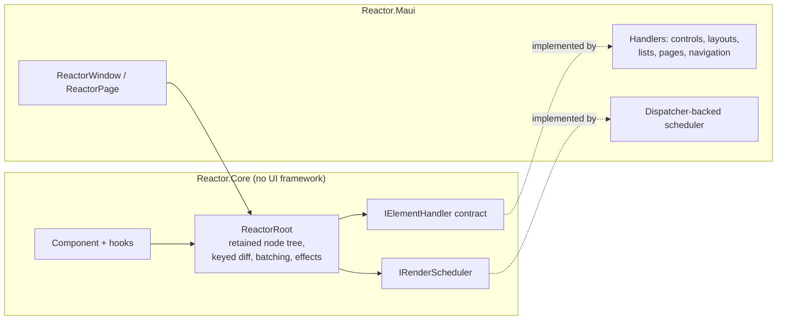

# Spec 065 — Reactor for .NET MAUI

> Status: preview. Grew out of a proof of concept on this branch. §6 records what has been verified
> and where, §7 what is still open.

## 1. Goal

Bring Reactor's programming model (immutable element records, components with React-style
hooks, keyed reconciliation, echo-safe controlled inputs) to .NET MAUI, so one component
model targets Android, iOS, Mac Catalyst and Windows through MAUI.

## 2. Decisions

| Decision | Choice | Why |
|---|---|---|
| Architecture | A renderer-neutral core plus one renderer per UI framework, as React splits `react-reconciler` from `react-dom` | The hooks, diffing and scheduling are the product; the target framework is a detail. |
| Renderer strategy | **Hybrid.** Direct views (MAUI Core interfaces, no Controls layer) for primitives and layouts; Controls for `CollectionView`, Shell, navigation and third-party controls | §4: direct is 27–58% faster on bulk work, but Controls owns virtualization, Shell and the ecosystem. |
| Location | This repo, as `src/Reactor.Core` and `src/Reactor.Maui` with their own solution (`Reactor.Maui.slnx`) and CI (`.github/workflows/maui.yml`, macOS) | Keeps the WinUI build and pipelines untouched while sharing the repo. |
| WinUI convergence | **Later**, as a separate project, once both renderers have proven the core's seams | Moving the 9,000-line WinUI reconciler is the riskiest step; a core designed from one consumer gets its seams wrong. |
| Names | `Microsoft.UI.Reactor.Core` and `Microsoft.UI.Reactor.Maui` (packages, assemblies and namespaces) | Component code stays source-compatible with WinUI Reactor. Renaming later is mechanical. |

## 3. Layout

| Project | Target | Role |
|---|---|---|
| `src/Reactor.Core` | `net10.0` | Renderer-neutral core: `Element`, `Component`, hooks, keyed reconciler, batched scheduler, handler contract. No UI framework reference. |
| `src/Reactor.Maui` | `net11.0` + `-android/-ios/-maccatalyst/-windows` | MAUI element records, both renderers (§4), `ReactorPage`. The plain `net11.0` target exists for headless tests. |
| `tests/Reactor.Core.Tests` | `net10.0` | Headless core tests against an in-memory fake renderer. |
| `tests/Reactor.Maui.Tests` | `net11.0` | Headless renderer tests: real Controls objects and direct views, no platform handlers. |
| `tests/Reactor.Maui.DeviceTests` | MAUI app | Device tier: fixtures that mount trees through the real platform handlers, act like the platform (taps, typing, back button, modal dismissal, tab selection) and check what the native views show. Prints TAP; `run.sh maccatalyst\|ios\|android`. |
| `tests/Reactor.Maui.Benchmark` | MAUI app | Renders the same tree through both renderers and reports timings and allocations. |
| `samples/maui/Reactor.Maui.Sample` | MAUI app | Gallery: tabs, a navigation stack held in state, counter, background-timer effect, keyed todo list, value controls, a `CollectionView`, the app hooks. `REACTOR_RENDERER=direct` switches renderer; `REACTOR_SAMPLE_ROUTE=<demo>` opens a demo at startup. |

`Reactor.Core` targets `net10.0` so the WinUI renderer (`net10.0-windows`) can consume it later.
The MAUI projects target `net11.0` because that is what the MAUI workload ships for SDK 11.
They inherit the repo-root MSBuild settings; `Directory.Packages.props` pins
`Microsoft.Maui.Controls` to the installed workload's `$(MauiVersion)`, and `samples/maui/`
chains straight to the root props to skip the WinUI-specific sample wiring.

```bash
dotnet restore Reactor.Maui.slnx -p:Configuration=Release
dotnet test tests/Reactor.Core.Tests --no-restore -c Release
dotnet test tests/Reactor.Maui.Tests --no-restore -c Release
dotnet build Reactor.Maui.slnx --no-restore -c Release

# Device tests: builds, installs, runs and gates on the TAP report (artifacts/device-tests/).
tests/Reactor.Maui.DeviceTests/run.sh maccatalyst
tests/Reactor.Maui.DeviceTests/run.sh ios          # the booted simulator
tests/Reactor.Maui.DeviceTests/run.sh android      # the attached device

# Sample (Mac Catalyst shown)
dotnet build samples/maui/Reactor.Maui.Sample -t:Run -f net11.0-maccatalyst

# Renderer benchmark: launch the Release app and read its REACTOR_BENCH lines (stderr on
# Mac Catalyst, `xcrun simctl launch --console-pty` on iOS, `adb logcat` on Android).
dotnet build tests/Reactor.Maui.Benchmark -c Release -f net11.0-maccatalyst
open --stderr /tmp/bench.log "tests/Reactor.Maui.Benchmark/bin/Release/net11.0-maccatalyst/Reactor Benchmark.app"
```

## 4. Two renderers: Controls and direct

Both renderers consume the same element records and the same `Reactor.Core`; only the
handler registry differs.

- **Controls renderer** (`Handlers/MauiHandlers.cs`). Reactor handlers create and update
  `Microsoft.Maui.Controls` objects (`Label`, `Entry`, `VerticalStackLayout`…), which MAUI's
  platform handlers then render. This is MauiReactor's architecture.
- **Direct renderer** (`Direct/`). Reactor owns small view classes that implement MAUI's Core
  interfaces (`ILabel`, `ITextButton`, `IEntry`, `IStackLayout`) as plain fields. MAUI's stock
  `LabelHandler`, `ButtonHandler`, `EntryHandler` and `LayoutHandler` render them, so there is no
  Controls object, bindable property, binding, style or logical tree involved. This is Comet's
  architecture. Register it with `builder.UseReactorDirectViews()` and pass
  `DirectHandlers.CreateRegistry()` to `ReactorPage`.

The direct renderer covers Label, Button, Entry, CheckBox, Switch, Slider, ProgressBar,
ActivityIndicator, Image, the two stacks and Grid. Every other element, and any element that uses
a setting only Controls implements (styles, gestures, shadows, clipping, brushes, Flex/Absolute
placement, `.Set()`; per element, for example Label `MaxLines`), falls back to the Controls
renderer in the same tree (`HybridHandler`). Mixing works in both directions because Controls
layouts accept any `IView` child. The one boundary is a Controls slot typed as `View` (page or
scroll view content), where a direct view is hosted in a reused `DirectViewHost` grid. A Controls
view inside a direct tree gets that host as its logical parent, so resources reach it. The sample
and the device fixtures run unchanged on either renderer, with identical geometry.

Three bugs found while building it show the cost of skipping Controls: every default Controls
supplies has to be re-derived.
- Text was larger until the direct views used the font manager's default size, as Controls does.
- On iOS every direct stack was pushed down by the safe-area inset until it stopped opting in to
  safe areas, which nested Controls layouts do through an internal interface (`ISafeAreaView2`).
- Direct labels didn't wrap on iOS and Mac Catalyst. Core's `ILabel` has no line-break mode;
  Controls maps `Label.LineBreakMode` (word wrap by default) itself, so a Core label keeps
  `UILabel`'s single truncated line. `DirectLabelHandler` adds the mapping.

Direct views implement `IVisualTreeElement`, so MAUI's visual-tree tools, inspectors and
test drivers see them. Controls layouts list only Controls elements as visual children, so
`DirectViewHost` re-implements the interface to list its direct child.

### 4.1 Benchmark results

1,000 keyed rows of `HStack(Label, Label, Button)`. Each operation is timed from the Reactor
render through a forced, complete native measure and arrange at the on-screen size. Values are
medians of 7 samples after 2 warm-ups, with the two renderers interleaved. Allocations are
managed bytes on the UI thread. Every sample is validated outside the timer (expected text,
arranged frames, row order and retained native views after Reverse), and both renderers
produced identical layout in every sample.

| Scenario | Pixel 10 (Android 16) | iPhone 18 Pro simulator (iOS 27) | Mac Catalyst (Apple silicon) |
|---|---|---|---|
| Mount 1,000 rows | 1,042 → 764 ms (−27%) | 3,514 → 2,394 ms (−32%) | 4,047 → 2,217 ms (−45%) |
| Update every row | 93 → 46 ms (−50%) | 693 → 478 ms (−31%) | 947 → 393 ms (−58%) |
| Update one row | 8.6 → 7.5 ms (−13%) | 48.8 → 46.4 ms (−5%) | 40.0 → 38.8 ms (−3%) |
| Reverse (keyed) | 160 → 84 ms (−47%) | 636 → 556 ms (−13%) | 713 → 629 ms (−12%) |
| Mount allocations | 42.4 → 10.5 MB (−75%) | 42.3 → 17.4 MB (−59%) | 58.4 → 21.7 MB (−63%) |
| Reverse allocations | 10.6 → 1.4 MB (−87%) | 8.7 → 3.3 MB (−62%) | 8.3 → 2.9 MB (−65%) |

Each cell is Controls → direct. What the numbers say:

- **Skipping Controls is a real win on bulk work**: 27–45% on mount, 31–58% on update-all, and
  60–87% fewer allocations on mount and reorder. Much of it is in layout, where Controls updates
  bindable `X`/`Y`/`Width`/`Height` and raises change events for every arranged view.
- **It doesn't matter for small updates.** Updating one row costs the same on every platform;
  native work dominates.
- **Part of the gap is features, not overhead.** The direct views have no styles, visual states,
  gestures, effects, bindings or semantics. Adding those back costs something.
- **Limits.** The iOS numbers come from a simulator, not a device. Drawing and compositing are not
  timed. Seven samples support rough comparisons, not small percentages.

Getting stable numbers on Android needed two methodology fixes, both in `BenchmarkPage.cs`.
Forced layout must use the real on-screen size: measuring at another size makes the forced and
real passes invalidate each other's native measure caches. And after forcing a .NET GC the
benchmark must wait. On Android every .NET GC also starts a concurrent Java GC, and the UI
thread blocks on it for about 600 ms at its next JNI call. A Perfetto trace attributed that
600 ms to ART's GC thread while the UI thread slept. The same effect hits real apps: a .NET GC
with thousands of live views can stall the next UI update. The runs also logged about 46,000
outstanding JNI global references, which is worth investigating separately.

## 5. What the core owns, and what a renderer supplies



A renderer implements, per control, `Mount`, `Update`, optional `Unmount`, and a children
strategy (`ChildrenStrategy.List` for panels, `ChildrenStrategy.Single` for content hosts).
The core does everything else.

Design choices that differ from today's WinUI Reactor, and why:

- **The core keeps its own node tree** instead of storing state on native controls through
  an attached property. That is what removes the dependency on any UI framework. Handlers
  wire events once at mount and read `context.Current` when the event fires.
- **Native controls are `object` to the core.** Each handler is strongly typed; the
  registry erases the types. Natives are always reference types, so nothing is boxed.
- **Components and groups produce no native control.** After reconciling, the core
  flattens each host's descendants into the ordered native children it should have and
  hands that list to the children strategy, which moves only what changed.
- **Echo suppression is a core primitive** (`HandlerContext.WriteSuppressed` /
  `IsEchoing`), so a programmatic write's change event is not reported as user input.

## 6. What has been proven

**Core, headless** (`tests/Reactor.Core.Tests`, 42 tests). Mounting through components and
groups. A keyed reorder keeps component state *and* the same native controls. Removal unmounts
and runs effect cleanups. Duplicate keys fail loudly, and changing the root's key remounts it.
Setters are batched into one posted flush, across components, and hosts are re-synced only after
the whole batch has rendered. Equal values don't re-render, and off-thread setters are posted to
the render thread. Effects run after commit, descendants before ancestors, and re-run only on
dependency changes. Hook order violations throw. Also covered: context (including readers in child
roots), `Memo`, `ErrorBoundary` with recovery, `UseResource` cancellation, controlled values
restored when a callback rejects input, `CanUpdate` remounts, and hot reload re-rendering every live
root. A boundary test fails if the core references anything but `System.*`.

**Renderer, headless** (`tests/Reactor.Maui.Tests`, 33 tests). Real Controls objects and direct
views, no platform handlers: modifiers, every control's props and echo-free events, the hybrid
fallback and mixed trees, `CollectionView` cells as child roots, pages, toolbar items, the
navigation stack's reconcile, the user-pop rule (below), tabs and flyout.

**Device tier** (`tests/Reactor.Maui.DeviceTests`, 20 fixtures). All pass on Mac Catalyst (macOS 26,
Apple silicon), an iPhone 18 Pro simulator (iOS 27) and a Pixel 10 (Android 16). They check what the
native views show, not the virtual tree:
- Taps reach state, and the platform label updates in place. Typing into a controlled `Entry` is
  corrected by the app's rule on the platform field. Keyed rows keep their typed text across a
  reorder. All of these run on both renderers.
- Grid geometry in window coordinates (column widths, row offsets, rows filling the page), and the
  content's top edge against the platform's safe-area inset (62 pt on the iPhone, 65.9 dp on the
  Pixel), for both renderers. Mac Catalyst is exempt: MAUI lays page content under its title bar
  there, whatever renders it.
- A long label wraps (several lines' height) on both renderers, with identical metrics.
- Navigation: a push reaches the platform stack (`UINavigationController` depth on iOS); the back
  button reaches app state; a back press *while the push animation still runs* is reported; a pop
  the app refuses is undone; the navigator's own pops are never reported as the user's; a modal
  dismissal is reported. Also: tab selection accepted and refused, `CollectionView` virtualizes
  (a few of 200 cells realized) and reports selection, `UseWindowSize` and `UseAppTheme` follow the
  window and the theme, an `ErrorBoundary` catches an event-handler failure, and effects clean up on
  unmount.

The device tier found two bugs the headless tiers could not. Both are fixed:
- **Back navigation was swallowed.** The navigator ignored `Popped` while one of its own operations
  was running, and on iOS `PushAsync`'s task stays pending well after the page has loaded. A back
  press in that window was dropped, and the navigator then pushed the page back. A user pop is now
  identified by the declaration, not timing: the navigator only ever pops pages the app no longer
  declares, so a pop of a still-declared page is the user's. The new depth is that page's position
  in the declared stack, because iOS raises `Popped` before it updates `NavigationStack`.
- **Direct labels didn't wrap** (§4).

**Packages.** `dotnet pack` produces both packages. A stock `dotnet new maui` app that references only
the packages builds the README's snippets unchanged and runs. The Maui package ships global usings
(the Reactor namespaces, plus an `Element` alias that beats `Microsoft.Maui.Controls.Element`)
through `buildTransitive`, with an opt-out (`ReactorImplicitUsings=false`).

**Sample.** Runs on all three platforms. Screenshots of the gallery, the controls page, the list
and the direct-renderer todos page were checked on the iPhone simulator.

## 7. Open issues

- **Windows is untested.** The packages target `net11.0-windows10.0.19041.0`, but this work was done
  on macOS; nothing has been built or run on Windows yet.
- **Implicit styles don't reach direct views.** An app's `Styles.xaml` styles Controls views only.
  Direct views take modifiers, or switch to Controls with `.Style()`.
- **Controls layouts with direct children.** A Controls layout (used when a layout element needs a
  Controls-only setting) still lists only its Controls children in the visual tree. Only
  `DirectViewHost` re-implements that.
- **Components never own a native control.** WinUI Reactor can wrap a component in a control so
  modifiers such as `Component<T>().Margin(8)` apply to it. This core treats components as
  purely compositional, so WinUI convergence needs a renderer-owned wrapper extension point.
- **Hot reload is verified headlessly only**, by invoking the metadata-update handler. It has not
  been exercised from an IDE session.
- **CI device runs.** `.github/workflows/maui.yml` runs the device tier on Mac Catalyst and an iOS
  simulator. Android runs locally only (an emulator on a hosted macOS runner is too slow). The
  workflow has not run on GitHub yet.
- **App projects must not be trimmable.** The repo enables `IsAotCompatible` everywhere, which marks
  app assemblies trimmable. Apple builds then trim them even in Debug, and drop `SceneDelegate`,
  which only `Info.plist` names. The result is a blank window. The sample sets
  `IsTrimmable=false`; any new app project in the repo must too.
- **About 46,000 outstanding JNI global references** were logged during the Android benchmark;
  worth investigating for leaks (§4.1).
