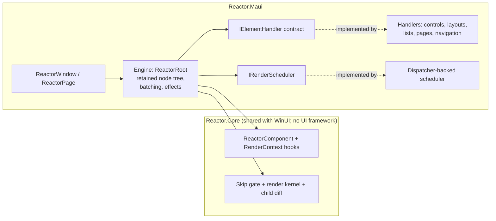

# Spec 065 — Reactor for .NET MAUI

> Status: preview. Grew out of a proof of concept on this branch. §6 records what has been verified
> and where, §7 what is still open.

## 1. Goal

Bring Reactor's programming model (immutable element records, components with React-style
hooks, keyed reconciliation, echo-safe controlled inputs) to .NET MAUI, so one component
model targets Android, iOS, Mac Catalyst and Windows through MAUI.

## 2. Decisions

| Decision | Choice | Why |
|---|---|---|
| Architecture | A renderer-neutral core plus one renderer per UI framework, as React splits `react-reconciler` from `react-dom` | The hooks, diffing and scheduling are the product; the target framework is a detail. |
| Renderer strategy | **Hybrid.** Direct views (MAUI Core interfaces, no Controls layer) for primitives and layouts; Controls for `CollectionView`, Shell, navigation and third-party controls | §4: direct is 27–58% faster on bulk work, but Controls owns virtualization, Shell and the ecosystem. |
| Location | This repo, as `src/Reactor.Maui` over the shared `src/Reactor.Core`, with its own solution (`Reactor.Maui.slnx`) and CI (`.github/workflows/maui.yml`, macOS) | Keeps the WinUI build and pipelines untouched while sharing the repo. |
| WinUI convergence | Superseded by spec 067, which extracts the shared core from the WinUI engine and re-hosts this renderer on it | Originally deferred: moving the 9,000-line WinUI reconciler is the riskiest step; a core designed from one consumer gets its seams wrong. |
| Names | `Microsoft.UI.Reactor.Maui`, over the shared `Microsoft.UI.Reactor.Core` | Spec 067 extracted the shared core from the WinUI engine; the transitional `Microsoft.UI.Reactor.Maui.Core` was deleted when this renderer moved onto it (spec 067 §13). |

## 3. Layout

| Project | Target | Role |
|---|---|---|
| `src/Reactor.Core` | `net10.0` | The core shared with WinUI (spec 067): `ReactorElement`, `ReactorComponent`, `RenderContext` and its hooks, `Context<T>`, the skip gate, the render kernel and the keyed child diff (`ChildReconciler`). No UI framework reference. |
| `src/Reactor.Maui` | `net11.0` + `-android/-ios/-maccatalyst/-windows` | The MAUI `Element` and `Component`, the node engine (`Engine/`: the retained node tree and its host for the core's child diff, batched scheduler, handler contract), MAUI element records, both renderers (§4), `ReactorPage`. The plain `net11.0` target exists for headless tests. |
| `tests/Reactor.Maui.Engine.Tests` | `net11.0` | Headless engine tests against an in-memory fake renderer. |
| `tests/Reactor.Maui.Tests` | `net11.0` | Headless renderer tests: real Controls objects and direct views, no platform handlers. |
| `tests/Reactor.Maui.DeviceTests` | MAUI app | Device tier: fixtures that mount trees through the real platform handlers, act like the platform (taps, typing, back button, modal dismissal, tab selection) and check what the native views show. Prints TAP; `run.sh maccatalyst\|ios\|android`. |
| `tests/Reactor.Maui.Benchmark` | MAUI app | Renders the same tree through both renderers and reports timings and allocations. |
| `samples/maui/Reactor.Maui.Sample` | MAUI app | Gallery: tabs, a navigation stack held in state, counter, background-timer effect, keyed todo list, value controls, a `CollectionView`, the app hooks. `REACTOR_RENDERER=direct` switches renderer; `REACTOR_SAMPLE_ROUTE=<demo>` opens a demo at startup. |

The shared core targets `net10.0` and references no UI framework; the MAUI renderer runs its
components, hooks and context on it (spec 067 §13). The MAUI projects target `net11.0` because that is what the MAUI workload ships for SDK 11.
They inherit the repo-root MSBuild settings; `Directory.Packages.props` pins
`Microsoft.Maui.Controls` to the installed workload's `$(MauiVersion)`, and `samples/maui/`
chains straight to the root props to skip the WinUI-specific sample wiring.

```bash
dotnet restore Reactor.Maui.slnx -p:Configuration=Release
dotnet test tests/Reactor.Maui.Engine.Tests --no-restore -c Release
dotnet test tests/Reactor.Maui.Tests --no-restore -c Release
dotnet build Reactor.Maui.slnx --no-restore -c Release

# Device tests: builds, installs, runs and gates on the TAP report (artifacts/device-tests/).
tests/Reactor.Maui.DeviceTests/run.sh maccatalyst
tests/Reactor.Maui.DeviceTests/run.sh ios          # the booted simulator
tests/Reactor.Maui.DeviceTests/run.sh android      # the attached device

# Sample (Mac Catalyst shown)
dotnet build samples/maui/Reactor.Maui.Sample -t:Run -f net11.0-maccatalyst

# Renderer benchmark: launch the Release app and read its REACTOR_BENCH lines (stderr on
# Mac Catalyst, `xcrun simctl launch --console-pty` on iOS, `adb logcat` on Android).
dotnet build tests/Reactor.Maui.Benchmark -c Release -f net11.0-maccatalyst
open --stderr /tmp/bench.log "tests/Reactor.Maui.Benchmark/bin/Release/net11.0-maccatalyst/Reactor Benchmark.app"
```

## 4. Two renderers: Controls and direct

Both renderers consume the same element records and the same engine; only the handler registry
differs.

- **Controls renderer** (`Handlers/MauiHandlers.cs`). Reactor handlers create and update
  `Microsoft.Maui.Controls` objects (`Label`, `Entry`, `VerticalStackLayout`…), which MAUI's
  platform handlers then render. This is MauiReactor's architecture.
- **Direct renderer** (`Direct/`). Reactor owns small view classes that implement MAUI's Core
  interfaces (`ILabel`, `ITextButton`, `IEntry`, `IStackLayout`) as plain fields. MAUI's stock
  `LabelHandler`, `ButtonHandler`, `EntryHandler` and `LayoutHandler` render them, so there is no
  Controls object, bindable property, binding, style or logical tree involved. This is Comet's
  architecture. Register it with `builder.UseReactorDirectViews()` and pass
  `DirectHandlers.CreateRegistry()` to `ReactorPage`.

The direct renderer covers Label, Button, Entry, CheckBox, Switch, Slider, ProgressBar,
ActivityIndicator, Image, the two stacks and Grid. Every other element (shapes and `ContentView` included,
spec 070 §4.3 and §4.5), and any element that uses
a setting only Controls implements (styles, gestures, shadows, clipping, brushes, Flex/Absolute
placement, `.Set()`, a ref typed to a Controls type such as `ElementRef<Entry>`; per element, for
example Label `MaxLines` or formatted `Inlines`), falls back to the Controls renderer in the same
tree (`HybridHandler`).
A ref typed to a Core interface (`ElementRef<IView>`) keeps the direct view, which can be focused
(spec 070 §2.5). Mixing works in both directions because Controls
layouts accept any `IView` child. The one boundary is a Controls slot typed as `View` (page or
scroll view content), where a direct view is hosted in a reused `DirectViewHost` grid. A Controls
view inside a direct tree gets that host as its logical parent, so resources reach it. The sample
and the device fixtures run unchanged on either renderer, with identical geometry.

Bugs found while building it show the cost of skipping Controls: every default Controls supplies,
and every comparison it makes, has to be re-derived.
- Text was larger until the direct views used the font manager's default size, as Controls does.
- On iOS every direct stack was pushed down by the safe-area inset until it stopped opting in to
  safe areas, which nested Controls layouts do through an internal interface (`ISafeAreaView2`).
- Direct labels didn't wrap on iOS and Mac Catalyst. Core's `ILabel` has no line-break mode;
  Controls maps `Label.LineBreakMode` (word wrap by default) itself, so a Core label keeps
  `UILabel`'s single truncated line. `DirectLabelHandler` adds the mapping.
- A direct check box remapped its color on every render: it compared a new paint per render by
  reference. The property census of spec 070 §4.14 found it (an equal render must write nothing);
  it compares the color now.

Direct views implement `IVisualTreeElement`, so MAUI's visual-tree tools, inspectors and
test drivers see them. Controls layouts list only Controls elements as visual children, so
`DirectViewHost` re-implements the interface to list its direct child. A Controls view's logical parent skips the direct layouts above it, so MAUI's
`ScrollView.ScrollToAsync(Element, …)` computes a wrong position through them; Reactor's
`ScrollToAsync(ElementRef<T>, …)` walks the visual parents instead (spec 070 §2.6.1).
The same gap breaks MAUI's radio button groups, which search logical children: a Controls radio
button inside a direct layout is never found as a peer. Reactor groups radio buttons itself, on both
renderers, from its own tree (spec 070 §3.6).

### 4.1 Benchmark results

1,000 keyed rows of `HStack(Label, Label, Button)`. Each operation is timed from the Reactor
render through a forced, complete native measure and arrange at the on-screen size. Values are
medians of 7 samples after 2 warm-ups, with the two renderers interleaved. Allocations are
managed bytes on the UI thread. Every sample is validated outside the timer (expected text,
arranged frames, row order and retained native views after Reverse), and both renderers
produced identical layout in every sample.

| Scenario | Pixel 10 (Android 16) | iPhone 18 Pro simulator (iOS 27) | Mac Catalyst (Apple silicon) |
|---|---|---|---|
| Mount 1,000 rows | 1,042 → 764 ms (−27%) | 3,514 → 2,394 ms (−32%) | 4,047 → 2,217 ms (−45%) |
| Update every row | 93 → 46 ms (−50%) | 693 → 478 ms (−31%) | 947 → 393 ms (−58%) |
| Update one row | 8.6 → 7.5 ms (−13%) | 48.8 → 46.4 ms (−5%) | 40.0 → 38.8 ms (−3%) |
| Reverse (keyed) | 160 → 84 ms (−47%) | 636 → 556 ms (−13%) | 713 → 629 ms (−12%) |
| Mount allocations | 42.4 → 10.5 MB (−75%) | 42.3 → 17.4 MB (−59%) | 58.4 → 21.7 MB (−63%) |
| Reverse allocations | 10.6 → 1.4 MB (−87%) | 8.7 → 3.3 MB (−62%) | 8.3 → 2.9 MB (−65%) |

Each cell is Controls → direct. What the numbers say:

- **Skipping Controls is a real win on bulk work**: 27–45% on mount, 31–58% on update-all, and
  60–87% fewer allocations on mount and reorder. Much of it is in layout, where Controls updates
  bindable `X`/`Y`/`Width`/`Height` and raises change events for every arranged view.
- **It doesn't matter for small updates.** Updating one row costs the same on every platform;
  native work dominates.
- **Part of the gap is features, not overhead.** The direct views have no styles, visual states,
  gestures, effects, bindings or semantics. Adding those back costs something.
- **Limits.** The iOS numbers come from a simulator, not a device. Drawing and compositing are not
  timed. Seven samples support rough comparisons, not small percentages.

Getting stable numbers on Android needed two methodology fixes, both in `BenchmarkPage.cs`.
Forced layout must use the real on-screen size: measuring at another size makes the forced and
real passes invalidate each other's native measure caches. And after forcing a .NET GC the
benchmark must wait. On Android every .NET GC also starts a concurrent Java GC, and the UI
thread blocks on it for about 600 ms at its next JNI call. A Perfetto trace attributed that
600 ms to ART's GC thread while the UI thread slept. The same effect hits real apps: a .NET GC
with thousands of live views can stall the next UI update. The runs also logged about 46,000
outstanding JNI global references, which is worth investigating separately.

## 5. What the core owns, and what a renderer supplies



A handler implements, per control, `Mount`, `Update`, optional `Unmount`, and a children
strategy (`ChildrenStrategy.List` for panels, `ChildrenStrategy.Single` for content hosts).
The engine and the shared core do everything else.

Design choices that differ from today's WinUI Reactor, and why:

- **The engine keeps its own node tree** instead of storing state on native controls through
  an attached property. A component node's state is the shared core's `ComponentNode`, so the
  core's skip gate and render kernel run on it. Handlers
  wire events once at mount and invoke callbacks through `context.Live` when the event fires:
  the current element, or `null` once it is unmounted, so a control that raises an event after
  teardown reaches no callback.
- **Native controls are `object` to the engine.** Each handler is strongly typed; the
  registry erases the types. Natives are always reference types, so nothing is boxed.
- **Removed views are disconnected.** Once the pass that removes a subtree has run, the engine hands
  its top-most native to the registry's release hook; MAUI's disconnects the view's handlers with its
  subtree (when it unloads, if it is still loaded), honoring `HandlerDisconnectPolicy.Manual`. Pages
  are left to MAUI's own disconnect after a pop. Reactor never reuses an unmounted view. Without
  this, a removed input view stayed subscribed to app theme changes, and on Android a theme change
  crashed on its released native views (spec 067 §16).
- **Controls are described or hand-written.** A public `ControlDescriptor<TElement, TView>` builds
  a handler from entries (`Property`, `OneWay`, `Initial`, `Controlled`, `Event`) with verbs modeled on WinUI's,
  and applies the element's modifiers like every built-in control (spec 067 §16). Eight built-ins use
  it; the rest are hand-written handlers.
- **The registry is per root, and the last registration wins**, so an app overrides a built-in
  handler by registering its own. `RegisterForDerivedTypes` registers one handler for a family of
  element records that share a non-generic base (for example the closed types of a generic record
  derived from it); an exact registration wins over it. The
  lookup is the shared core's (spec 067 §15).
- **Components and groups produce no native control.** After reconciling, the engine
  flattens each host's descendants into the ordered native children it should have and
  hands that list to the children strategy, which moves only what changed.
- **Echo suppression is an engine primitive** (`HandlerContext.WriteSuppressed` /
  `IsEchoing`), so a programmatic write's change event is not reported as user input.
  `IsEchoing` is also true once the element is unmounted. Every controlled form control raises its
  change event synchronously inside the write, so a scope around the write is enough for them
  (spec 067 §14 lists the controls not characterized yet).
- **Typed navigation is WinUI's API over the shared model** (spec 069). `UseNavigation` and
  `NavigationHandle<TRoute>` keep the core's `NavigationStack`; `NavigationHost` is a built-in
  component that declares the back stack and current route as a `NavigationStack` (one key per
  entry) and drives the lifecycle through a non-generic binding the stack's handler calls. It finds
  the active page's lifecycle hooks in the node tree, and completes a navigation when the navigator
  is idle, no user pop is pending and every model change has been shown. A user's pop becomes one
  guarded navigation to the declared depth; Android's back key is a guarded back from the page shown
  that `ReactorNavigationPage` consumes. `NavigationStackElement.Animated` applies to the operations
  toward that declaration; the host's configured stack sets its default. A throwing lifecycle
  callback is reported to its component's error boundaries (`ReactorRoot.ReportCallbackError`).
- **Shell is declarative** (spec 069 §4). Reactor builds every Shell object itself and keys the tabs
  and top tabs by the app's keys; `ReactorShell` holds the declared selection, applies it at the level
  it names, and reports a user's switch from `Navigated`, comparing what Shell shows with what Reactor
  last selected. Collections sync in stages (add, select, remove, reorder around the current item), so
  the selection never rests on MAUI's fallback for a removed current item. The host binding talks to an
  internal `INativeStack`: a `NavigationPage`'s `StackNavigator`, or a Shell section's
  `ShellSectionNavigator`, which pushes and pops through the section one awaited operation at a time,
  tags them as its own, preflights the user's back in `Shell.Navigating` and stays busy until the
  platform has finished it (the iOS transition coordinator, `Navigated`, or a cancel), holding app
  navigations meanwhile; on Android the back key is a guarded back of the model taken in
  `ReactorShell.OnBackButtonPressed`. A page change waits while the section's own modal is shown. Both
  navigators share `OwnedModals`. `WindowPageSetter` waits for a busy section as for a busy navigation
  page, including one whose Shell has just unmounted (it stays listed until it settles).
- **Dialogs, the back key and the window's lifecycle are hooks on the engine** (spec 069 §5). A hook
  finds its node through the root's render owner while it renders. Dialogs go through one queue per
  window (`DialogQueue`), on the window's dispatcher, over an `IDialogPlatform` that shows MAUI's page
  dialogs and tells when the native dialog has gone; the declarative dialogs are `ComponentElement`
  records over a component that renders nothing. `UseSystemBackButton` handlers join their window;
  on Android a window with handlers gets one AndroidX back callback, added after MAUI's and enabled
  only while a handler is registered, which asks the visible page's handlers and otherwise passes the
  key on to MAUI. `UseWindowSize`, `UseDialogs`, `UseWindowLifecycle` and `UseSystemBackButton` find a
  hosted page's window through one resolver (`WindowTracking`, following the page's `Window`), and
  `ReactorWindow` unmounts its tree in `OnDestroying`, after the `Destroying` event's handlers.

## 6. What has been proven

**Engine, headless** (`tests/Reactor.Maui.Engine.Tests`, 73 tests). It runs the renderer conformance
scenarios WinUI runs, with the same expected results (spec 067 §13.6–13.7). Mounting through components and
groups. A keyed reorder keeps component state *and* the same native controls. Removal unmounts
and runs effect cleanups. Duplicate keys fail loudly, and changing the root's key remounts it.
Setters are batched into one posted flush, across components, and hosts are re-synced only after
the whole batch has rendered. Equal values don't re-render, and off-thread setters are posted to
the render thread. Effects run after commit, descendants before ancestors, and re-run only on
dependency changes. Hook order violations throw. Also covered: context (including readers in child
roots), `Memo`, `ErrorBoundary` with recovery, `UseResource` cancellation, controlled values
restored when a callback rejects input, `CanUpdate` remounts, and hot reload re-rendering every live
root, and errors a handler reports from its own asynchronous work (`HandlerContext.ReportError`)
reaching boundaries. A boundary test fails if the core references anything but `System.*`. The
shared navigation model (spec 069): the stack's operations and guard order, `PopToIndex` bounds,
state restored without guards, the lifecycle hook's order and lookup, and a handle over an injected
scheduler (including one that refuses).

**Renderer, headless** (`tests/Reactor.Maui.Tests`, 213 tests). Real Controls objects and direct
views, no platform handlers: modifiers, every control's props and echo-free events, the hybrid
fallback and mixed trees, `CollectionView` cells as child roots, pages, toolbar items, the
navigation stack's reconcile, the user-pop rule (below), tabs and flyout (including swapping the
two flyout pages between slots). `NavigationHost` (spec 069): every handle operation reaching the
stack, entry keys (routes equal only by string or hash, equal routes at two positions, replace,
pages below a push or pop kept mounted), a refusing guard, WinUI's lifecycle order, a refusing
destination (the previous page stays mounted), a superseded navigation (every page left is told,
only the latest destination arrives, including a back key right after a push), a user's back
accepted, refused, several levels deep and while the model has moved on, a refused destination asked
again by the user's back or the back key, the back key before a push is shown, at the root or above it (consumed, superseding it), a nested host owning its
pages, unmounting and re-binding the host, a page replacing its own native page after a push,
throwing callbacks reaching error boundaries (including one that survived its component's
replacement), `Animated` from the options (ending with that navigation) and the host's configured
default (and the stack's title in tabs), `SetState` into a mounted host and off the render thread,
context for descendants, off-thread calls on two roots and a refusing scheduler, hot reload keeping
the history, allocation-free mutators, and the README snippet. Shell (spec 069 §4): items, tabs and
top tabs built, updated, reordered and removed (keeping their objects), duplicate keys, selection from
code at each level and from the user (reported once, from `Navigated`), a refused switch restored
(also after rapid switches), no selection and an unknown key's fallback reported once, the selected
tab removed with the declared one selected first, stacks in tabs (the root as the content's page,
kept across selection, two sections navigating at once), the user's back accepted, refused by either
guard, to the root (`PopToRoot`), at the root and during a modal, the iOS swipe's state machine
(completed, cancelled, never settling, a deferral longer than the warning, a transition ending
without `Navigated`, a second offer, cancelled by another handler, with an app navigation held
through it), a back the host can't preflight (before a push is shown, during a push), the Android
back key as a guarded model back (accepted, refused by either guard, at the root), the window swap
waiting for a busy section (also after a root swap unmounts the Shell), modals (a page change held
while one is shown, a user dismissal reported, dismissed when the Shell unmounts, a host tab removed
with its modal shown or mid-push), modal route pages rejected, a tab's content changing from a deep
host, a host replaced by another (one pop to the root, after the replaced one's operation, also
through a chain of replacements), an own operation or the Android back key's pop cancelled by another
handler (not retried, model unchanged; a declaration made meanwhile still tried), two and three quick
back-key presses (a level each, each guard once, also when later pops complete at once), a key-back pop
that throws (reported, the navigator idle and usable), a Shell mounted over a handle with a history,
a nested host in a tab's page, conditional tabs, the pages' Shell properties, the flyout, and the
README snippet. Dialogs, the back key and the lifecycle (spec 069 §5): the dialog queue's order, one
dialog at a time per window, the dismissal barrier (and Android's posted turn) and the hold during a
navigation until the navigator is idle (in the page and in a modal), a failed presentation completing
with the cancel answer (reported to the caller's boundary when it has one) while the queue moves on,
a destroyed window completing its dialogs and settling later requests until it is created again, a
refused dispatch (of a request or of an answer) or a termination during a presentation settling everything and making the queue terminal, a
failure report the render thread refuses still completing the task, the presenter resolved at dequeue (the top modal), a late
window and a hosted page leaving its window; declarative dialogs queued once per open, their stale
answers dropped (unmounted, closed, re-opened, closed in the render that brings the window), a stale
dialog never shown, the answer going to the `OnClosed` of the content shown, and `OnClosed` or
presentation errors reaching the element's boundary; back handlers asked only on the visible page
(not a page below the top, a deselected tab, a deselected Shell tab, a `NavigationHost` in a
deselected tab, a covered `ReactorPage` or a list cell in a deselected tab), deepest first, then the
most recent, each once, across two trees, with the root's handlers asked over a modal, falling
through to MAUI and the host's guarded back, once per back whether Reactor's callback or the Shell's
back path asks first (and twice for two backs in one turn), the handle overload consuming a refused back, a throwing
handler, and a page's own `SendBackButtonPressed` asking none; the window's lifecycle subscribed,
refreshed and unsubscribed, found late, left when a hosted page leaves its window, and `onDestroying`
running before the teardown, with its errors held until after it; `ModalPresentationStyle` written
before the modal is presented; and the README snippets.

**Device tier** (`tests/Reactor.Maui.DeviceTests`, 93 fixtures; platform no-ops report TAP's `# SKIP`). All pass on Mac Catalyst (macOS 26,
Apple silicon), an iPhone 18 Pro simulator (iOS 27) and the Android API 37 emulator; the 25 earlier
ones also ran on a Pixel 10 (Android 16). They check what the
native views show, not the virtual tree:
- Taps reach state, and the platform label updates in place. Typing into a controlled `Entry` is
  corrected by the app's rule on the platform field. Keyed rows keep their typed text across a
  reorder. All of these run on both renderers.
- Grid geometry in window coordinates (column widths, row offsets, rows filling the page), and the
  content's top edge against the platform's safe-area inset (62 pt on the iPhone, 65.9 dp on the
  Pixel), for both renderers. Mac Catalyst is exempt: MAUI lays page content under its title bar
  there, whatever renders it.
- A long label wraps (several lines' height) on both renderers, with identical metrics.
- Echo, on both renderers (spec 067 §14): Reactor's writes to the eleven controlled form controls
  report nothing, at once or later; a coerced write shows the coerced value and reports nothing,
  without looping; input the app refuses is reported once and restored; input after unmount is not
  reported. A page the app removes doesn't report `OnDisappearing`; a covered page does. Removed
  views are disconnected (siblings that stay are not, nor a popped page's content while it animates
  out), and app theme changes after their removal don't crash.
- Navigation: a push reaches the platform stack (`UINavigationController` depth on iOS); the back
  button reaches app state; a back press *while the push animation still runs* is reported; a pop
  the app refuses is undone, including when the navigator is idle; an accepted back never re-pushes
  the page; the navigator's own pops are never reported as the user's; a modal dismissal is
  reported; unmounting mid-navigation stops further pushes; two stacks in tabs share the window's
  modal stack without dismissing each other's modals; an unmounted stack's modal that is buried
  under another stack's modal is dismissed once it is uncovered; replacing the window's content while a
  stack pushes or pops shows the new content and survives the interrupted operation, which on Android
  needs the window-page wait (§7). `NavigationHost`: the handle's push, pop, replace, `PopTo`, reset
  and `SetState` reach the platform stack; MAUI's pop, the platform's own back
  (`PopViewController` on iOS and Mac Catalyst, the activity's back dispatcher on Android), the back
  key and a back key while the push still animates each run the guard exactly once, accepted or
  refused, and a consumed key never makes MAUI pop as well; the lifecycle runs in WinUI's order, with
  `onNavigatedTo` only once the navigator is idle; the animation argument of each push, pop and modal
  follows `NavigateOptions.Animated` and the host's configured default. Shell (spec 069 §4.6), each
  checking the page the platform displays and, on iOS and Mac Catalyst, the section's native depth:
  a tab tap reported and a refused one undone (also rapid taps, refused and accepted); push, pop,
  reset and a new root in a tab; a restored history; the native back (the back button's path on iOS
  and Mac Catalyst, the back dispatcher on Android) accepted with the guard once and the callbacks in
  order, refused by either guard with no page moving; back at the root passed on; stacks kept across
  tab switches; rapid push, switch and back, and a back right after a push not yet shown;
  reordering and removing the selected tab; `NavBarIsVisible` and `TabBarIsVisible` live (read from
  the native bars on all three); the flyout header and content updated in place and the user's
  flyout reported; a modal from a Shell page, with a push held until it goes; typed reset and a back
  with a result kept in state; a Shell remounted over a handle with a history; a deep link; and a root swap from the Shell to a page waiting for a busy
  section. Also: tab selection accepted and refused, `CollectionView` virtualizes
  (a few of 200 cells realized) and reports selection, `UseWindowSize` and `UseAppTheme` follow the
  window and the theme, an `ErrorBoundary` catches an event-handler failure, and effects clean up on
  unmount.
- Dialogs and the back key (spec 069 §5): an alert with one and two buttons, an action sheet, a
  prompt and a declarative alert, each answered through its native button (clicked in process on
  Android; on iOS and Mac Catalyst the chosen action's own handler runs as the alert dismisses), with
  the native dialog gone afterwards; two queued dialogs never on screen at once (none left on screen
  when the next is presented); a dialog requested during a push shown only once it has finished; a
  dialog on a modal opened after an earlier dialog shown on it at once; a dialog requested from a
  background thread; an alert shown outside the queue not holding a Reactor dialog back; and on iOS
  and Mac Catalyst, an answer arriving before its alert has gone holding the next dialog until it has
  (also after a forced collection), and neither an alert an `OnClosed` opens nor one with the same
  title opened during the presentation taken for the queue's own. On Android: the back key reaching a `UseSystemBackButton` handler before a
  `NavigationHost`, at the root (handled, and unhandled reaching the platform's default), a real back
  key on a modal (the modal's handler, then the root's, then MAUI popping it) and in a Shell (the
  handler once, before the Shell's guarded back), the handle overload consuming a back the guard refuses, and Reactor's callback enabled only with a handler on
  a `Page` and a `Tabs` root (MAUI's off, so the predictive preview stays); the window's `Stopped` and
  `Resumed` while another activity covers the app's. A `PageSheet` modal on iOS (full
  screen on Mac Catalyst), dismissed by the app and at unmount.

The device tier found two bugs the headless tiers could not. Both are fixed:
- **Back navigation was swallowed.** The navigator ignored `Popped` while one of its own operations
  was running, and on iOS `PushAsync`'s task stays pending well after the page has loaded. A back
  press in that window was dropped, and the navigator then pushed the page back. A user pop is now
  identified by the declaration, not timing: the navigator only ever pops pages the app no longer
  declares, so a pop of a still-declared page is the user's. The new depth is that page's position
  in the declared stack, because iOS raises `Popped` before it updates `NavigationStack`.
- **Direct labels didn't wrap** (§4).

An independent review (a different model family) of the navigation code found more, each
reproduced before it was fixed and covered by a fixture that fails without the fix:
- An accepted back navigation re-pushed the page once (a visible flicker on iOS and Android). The
  handler ran the navigator from `Update`, which the engine calls before syncing the new children,
  so it reconciled against the previous declaration. It now runs only for an unchanged element
  (the restore after a refused pop).
- iOS raises `Popped` before it removes the page, so a refused pop could be judged "already
  settled". The navigator now gives a platform pop a short grace period (about one pop animation)
  and keeps re-checking until the page has gone. MAUI can also raise `Popped` mid-push and keep the
  page; the grace period bounds how long that delays the fix-up.
- The window's modal stack is shared: a second navigation stack dismissed the first one's modal.
  Each navigator now manages only the modals it presented.
- Navigation failures were lost in a discarded task; they now reach error boundaries through
  `HandlerContext.ReportError`. Unmounting now stops pending navigation and, once its current
  operation ends, dismisses the modals the stack presented, through the window (the navigation page
  may already have left it); a modal covered by another stack's modal goes when it is uncovered. A swap of the two flyout pages threw; it now goes through placeholders.

**Packages.** `dotnet pack` produces both packages. A stock `dotnet new maui` app that references only
the packages builds the README's snippets unchanged and runs. The Maui package ships global usings
(the Reactor namespaces, plus `Element` and `NavigationMode` aliases that beat
`Microsoft.Maui.Controls.Element` and `Microsoft.Maui.ApplicationModel.NavigationMode`)
through `buildTransitive`, with an opt-out (`ReactorImplicitUsings=false`).

**Sample.** Runs on all three platforms. Screenshots of the gallery, the controls page, the list
and the direct-renderer todos page were checked on the iPhone simulator.

## 7. Open issues

- **Windows is untested.** The packages target `net11.0-windows10.0.19041.0`, but this work was done
  on macOS; nothing has been built or run on Windows yet.
- **Implicit styles don't reach direct views.** An app's `Styles.xaml` styles Controls views only.
  Direct views take modifiers, or switch to Controls with `.Style()`.
- **Controls layouts with direct children.** A Controls layout (used when a layout element needs a
  Controls-only setting) still lists only its Controls children in the visual tree. Only
  `DirectViewHost` re-implements that.
- **Components never own a native control.** WinUI Reactor can wrap a component in a control so
  modifiers such as `Component<T>().Margin(8)` apply to it. The MAUI engine treats components as
  purely compositional, so WinUI convergence needs a renderer-owned wrapper extension point.
- **Hot reload is verified headlessly only**, by invoking the metadata-update handler. It has not
  been exercised from an IDE session.
- **CI device runs.** `.github/workflows/maui.yml` runs the device tier on Mac Catalyst and an iOS
  simulator on every PR and push to `main` that touches the MAUI paths it lists. Android runs locally only (an emulator on a hosted macOS runner is too slow).
- **App projects must not be trimmable.** The repo enables `IsAotCompatible` everywhere, which marks
  app assemblies trimmable. Apple builds then trim them even in Debug, and drop `SceneDelegate`,
  which only `Info.plist` names. The result is a blank window. The sample sets
  `IsTrimmable=false`; any new app project in the repo must too.
- **A platform pop is tracked for at most 3 s.** If MAUI were to keep a refused page in its stack
  longer than that, the navigator would settle against it and not restore the page when it finally
  left. Not observed on any platform (pops leave within about 0.6 s).
- **MAUI bug on Android: replacing `Window.Page` while a `NavigationPage` push is in flight**
  crashes the app ("NavigationManager cannot be null here", from
  `NavigationViewFragment.OnCreateView`). Reproduced with plain MAUI, no Reactor involved. A
  `ReactorWindow` hit it when its root switched away from a `NavigationStack` mid-push. **Worked
  around (phase 4a):** on Android, `WindowPageSetter` (used by `ReactorWindow`) replaces the page
  only once every navigation stack in the outgoing page (the page itself, or one in its tabs or
  flyout) has finished its platform operation. The device fixture
  `Window_ReplacingThePageDuringRepeatedPushesAndPops_DoesNotCrash` crashed in 5 of 10 runs without
  the wait and 0 of 18 with it. A stack inside `Tabs` didn't crash without the wait (0 of 6); the
  setter waits for it anyway, and a fixture covers it. Phase 3e also hit "CurrentPage cannot be null", from the same frame,
  during a pop; that variant hasn't been reproduced since, with or without Reactor. Still worth
  filing in dotnet/maui. The wait covers navigation Reactor's navigator runs, not a platform back
  gesture in flight at the moment of the swap.
- **Android's predictive back-to-home preview at the root.** Android shows it only while no back
  callback is enabled. Reactor's callback is enabled only while a `UseSystemBackButton` handler is
  registered in the window (spec 069 §5.2), so the preview is lost then, and only then, for a `Page`
  or `Tabs` root. MAUI keeps its own callback enabled for a page that overrides `OnBackButtonPressed`,
  which `NavigationHost`'s navigation page and Reactor's Shell do (since 4b-1 and 4b-2), so a root
  of either never shows the preview.
- **MAUI bug on Mac Catalyst: a sheet-style modal can't be dismissed.** With
  `ModalPresentationStyle.PageSheet`, MAUI's `PopModalAsync` never completes on Mac Catalyst 26.7
  (`DismissViewControllerAsync` doesn't return), and every later modal of the window then waits. So
  Reactor applies the style on iOS only (spec 069 §5.6). Worth filing in dotnet/maui.
- **About 46,000 outstanding JNI global references** were logged during the Android benchmark;
  worth investigating for leaks (§4.1).
