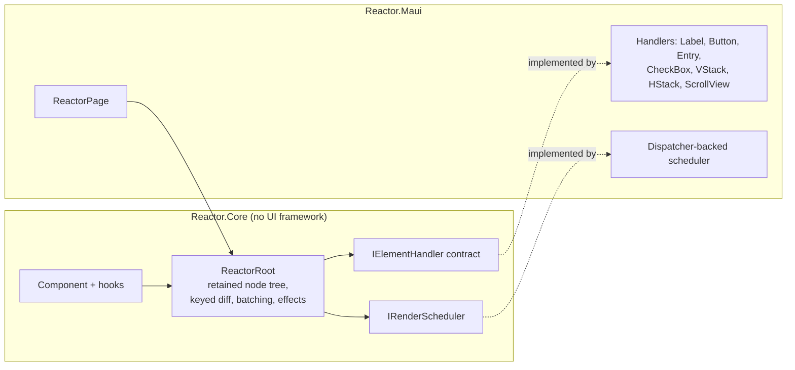

# Reactor on .NET MAUI: proof of concept

> **Experimental.** Nothing here ships, nothing here is in `Reactor.slnx` or CI, and nothing
> under `src/` depends on it. Delete the folder and the repo is unchanged.

This proof of concept answers one question: can Reactor's programming model (components,
hooks, keyed reconciliation) run on a renderer-neutral core, with .NET MAUI as a second
renderer next to WinUI?

It is structured the way a real product would be, so a "yes" doesn't mean a rewrite:

| Project | Target | Role |
|---|---|---|
| `src/Reactor.Core` | `net10.0` | Renderer-neutral core: `Element`, `Component`, hooks, keyed reconciler, batched scheduler, handler contract. No UI framework reference. |
| `src/Reactor.Maui` | `net11.0-android/ios/maccatalyst/windows` | MAUI renderer: element records, one handler per control, `ReactorPage` host. |
| `samples/Reactor.Maui.Sample` | MAUI app | Counter, background-timer effect, todo list with keyed rows. |
| `tests/Reactor.Core.Tests` | `net10.0` | Headless core tests against an in-memory fake renderer. |

`Reactor.Core` targets `net10.0` so the existing WinUI renderer (`net10.0-windows`) could
consume it too. The MAUI projects target `net11.0` because that is what the MAUI workload
ships for SDK 11.

## Build, test, run

Everything in this folder builds in isolation: its own `Directory.Build.props`/`.targets`
and `Directory.Packages.props` stop MSBuild from picking up the repo's WinUI build logic.

```bash
cd experimental/maui

# Core tests (any OS)
dotnet test tests/Reactor.Core.Tests

# Sample app (needs the maui workload; Mac Catalyst shown)
dotnet build samples/Reactor.Maui.Sample -t:Run -f net11.0-maccatalyst
```

## What the core owns, and what a renderer supplies



A renderer implements, per control, `Mount`, `Update`, optional `Unmount`, and a children
strategy (`ChildrenStrategy.List` for panels, `ChildrenStrategy.Single` for content hosts).
The core does everything else.

Design choices that differ from today's WinUI Reactor, and why:

- **The core keeps its own node tree** instead of storing state on native controls through
  an attached property. That is what removes the dependency on any UI framework. Handlers
  wire events once at mount and read `context.Current` when the event fires.
- **Native controls are `object` to the core.** Each handler is strongly typed; the
  registry erases the types. Natives are always reference types, so nothing is boxed.
- **Components and groups produce no native control.** After reconciling, the core
  flattens each host's descendants into the ordered native children it should have and
  hands that list to the children strategy, which moves only what changed.
- **Echo suppression is a core primitive** (`HandlerContext.WriteSuppressed` /
  `IsEchoing`), so a programmatic write's change event is not reported as user input.

## What has been proven

Core, headless (`tests/Reactor.Core.Tests`, 21 tests): mounting through components and
groups; keyed reorder keeps component state *and* the same native controls; removal
unmounts and runs effect cleanups; duplicate keys fail loudly; changing the root's key
remounts it; setters are batched into one posted flush, across components, and hosts are
re-synced only after the whole batch has rendered; equal values don't re-render; off-thread
setters are posted to the render thread; children with equal props skip re-rendering but
still receive the latest props; effects run after commit, descendants before ancestors, and
re-run only on dependency changes, even when a setter runs during render; hook order
violations throw; controlled input doesn't echo. A boundary test fails if the core ever
references anything but `System.*`. Each of these behaviours was confirmed to have a test
that fails when the code under test is broken.

MAUI, at runtime on Mac Catalyst (driven through real input, verified through the
accessibility tree): clicks update state; a `System.Threading.Timer` updates state every
second from a background thread; typing into the controlled draft `Entry` keeps every
character in order while that timer re-renders; Add clears the draft through state;
Reverse moves rows *with* the text typed into each row's own note `Entry`, so keyed state
follows the row; toggling and removing rows update the derived count. The sample also
builds for iOS and Android.

## Findings to resolve before this becomes real

- **Type-name collisions with MAUI.** MAUI declares its own `Microsoft.Maui.IElementHandler<,>`
  and `Microsoft.Maui.Controls.Element`, and MAUI projects import those namespaces implicitly.
  The renderer qualifies the handler interface, and both the renderer and the sample add a
  global `using Element = Microsoft.UI.Reactor.Core.Element` alias (a package would ship the
  sample's through `buildTransitive`). Renaming the core's handler interface is worth considering.
- **Namespace and branding.** Core types keep the namespaces they have in WinUI Reactor today
  (`Microsoft.UI.Reactor.Core` for `Element`, `Component`, `RenderContext`), so component code
  keeps compiling when they move into this assembly. That name is WinUI-flavoured; a neutral
  name would be a deliberate, source-breaking product decision.
- **Components never own a native control.** WinUI Reactor today can wrap a component in a
  control so modifiers such as `Component<T>().Margin(8)` apply to it. This core treats
  components as purely compositional, so moving WinUI onto it needs a renderer-owned wrapper
  extension point, not just handlers. Prototype that before committing to the migration.
- **No error recovery.** A render, effect or cleanup that throws leaves the root in an undefined
  state: unprocessed dirty components are not re-queued, a half-mounted subtree is not rolled
  back, and teardown stops at the first failing cleanup. This belongs with error boundaries.
- **Controlled values only re-assert on re-render.** If an `OnTextChanged` callback rejects
  input *without* changing state, nothing re-renders, so the control keeps the rejected text.
  React re-asserts the value anyway; this core does not yet.
- **Host lifetime is explicit.** `ReactorPage.Unmount()` runs every cleanup; the sample calls it
  when its window is destroyed. Navigation would need to decide when a page is gone for good.
- **Not built yet:** hot reload, context (`UseContext`), error boundaries, navigation and
  multiple pages, virtualized lists (`CollectionView`), styling and theming, layout modifiers
  beyond margin/width/horizontal options, element pooling, and diagnostics.

## The path to a real product

1. Grow the MAUI renderer against this core until it covers a realistic app (navigation,
   `CollectionView`, context, hot reload), and measure it against XAML and MauiReactor.
2. Move WinUI Reactor onto `Reactor.Core`: its reconciler becomes handlers plus a children
   strategy, gated by the existing unit, selftest and E2E suites, and by `perf-compare`.
3. Decide where the MAUI renderer lives long-term (this repo, dotnet/maui, or its own repo).
   It ships on MAUI's cadence and needs Android and iOS CI, which this repo doesn't run.
